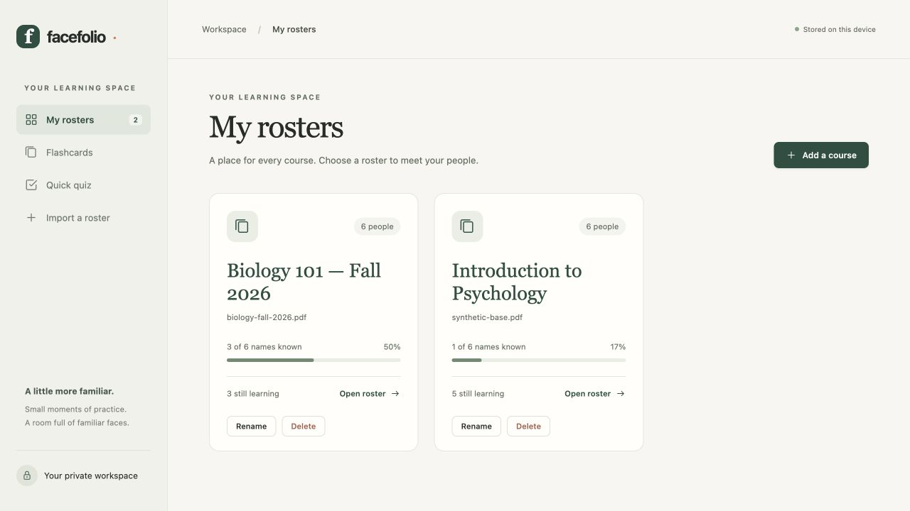

# Facefolio

Turn a PDF photo roster into a set of flashcards and name quizzes. Keep a separate roster for each course, learn names at your own pace, and upload an updated PDF when enrollment changes.

Facefolio runs locally in your browser. It needs no account, API key, backend, or build step. PDF processing and saved rosters stay in your browser on your device.



## Get started

### Requirements

- Python 3 to run the local web server.
- A current desktop browser with JavaScript and browser storage enabled.
- A photo roster PDF with selectable names beneath individual photos. See [supported PDFs](#supported-pdfs).

Node.js and npm are only needed for development checks, not for using the app.

### Download

On [GitHub](https://github.com/soapytofu/face-folio), choose **Code → Download ZIP** and extract it. Or use Git:

```sh
git clone https://github.com/soapytofu/face-folio.git
cd face-folio
```

### Start the app

**macOS:** double-click `start.command` in the downloaded folder. If it does not open, use the terminal command below.

**macOS or Linux:** open a terminal in the project folder and run:

```sh
python3 serve.py
```

**Windows:** open PowerShell in the project folder and run:

```powershell
py -3 serve.py
```

If your Python installation uses `python` instead, run `python serve.py`.

The launcher opens [http://127.0.0.1:4173](http://127.0.0.1:4173). Keep the terminal window open while using the app. Press **Control-C** to stop it; saved rosters remain in that browser.

To start without automatically opening a browser:

```sh
python3 serve.py --no-open
```

Use the same browser and the exact address each time. `localhost`, `127.0.0.1`, different ports, and a hosted copy have separate browser storage. Do not double-click `dist/index.html`: PDF workers and ES modules require a web server.

## Use Facefolio

### Add and manage courses

1. Choose **Add a course** in **My rosters**, or **Import a roster** in the sidebar.
2. Leave **Upload destination** set to **Create a new roster** and choose or drop a PDF.
3. Review the imported photos, names, and details before studying. Use **Edit details** to correct a match, replace a photo, or add missing information.
4. Return to **My rosters** to see a card for every course, including its size and learning progress.

Each card has **Rename** and **Delete** buttons. Renaming keeps the roster and its progress. Deleting requires confirmation and removes that course's photos, notes, and progress from the current browser. The confirmation includes **Export backup**; deletion has no undo.

Click the main area of a course card to open its roster. Use **Back to my rosters** to return to the grid. Inside a course, the sidebar dropdown lets you switch rosters while reviewing or studying. Duplicate titles are distinguished by a copy number and import time.

### Review people

Each person can have a photo, name, major, school/degree/program, class year, pronouns, and notes. The importer fills fields it can read; it does not invent missing information. Major remains blank unless explicitly labeled in the PDF.

Search names and details, filter by learning progress, add or remove people, and use **Edit details** for corrections. The **••• Roster settings** button inside a roster also lets you change its title or reset its learning progress.

### Study with flashcards

Choose **Start studying** or **Flashcards**. Look at the face, recall the name, then flip the card. Mark **Know it** or **Still learning**, or skip and come back later. Use **Everyone** or **Still learning** to select a practice group, and **Shuffle** for a fresh order.

| Shortcut | Action |
| --- | --- |
| Space | Flip the focused flashcard |
| 1 | Mark Still learning after revealing the name |
| 2 | Mark Know it after revealing the name |
| Left arrow | Previous card |
| Right arrow | Skip to the next card |

The results distinguish reviewed cards from skipped cards and offer **Review skipped cards**. Revealing a card counts as reviewing it; rating it also records learning progress.

### Quiz yourself

**Quick quiz** starts in **Type the name** mode. A first name is enough, even if two people share it. Full names also work; case, accents, and punctuation are ignored. An unambiguous first-and-last name can omit middle names. Misspellings are not matched fuzzily.

Press Enter to check an answer, then Enter on the focused next-person button to continue. **I don't know — show the name** reveals an answer. You can also switch to **Multiple choice**; number keys 1–4 choose an option.

Correct answers mark a person known; incorrect or revealed answers mark them still learning.

### Resume later

Rosters, edits, and known/still-learning progress are saved in IndexedDB in your browser. The selected tab, course, current flashcard, flipped side, shuffle order, quiz draft, and round results are restored when refreshing the same browser tab. Each course keeps separate flashcard and quiz rounds while you navigate.

Round position uses session storage: it is intended to survive refresh, not to sync across devices or guarantee recovery after closing a tab. Browser privacy settings, clearing site data, and storage limits can affect saved data. Export backups for anything you need to keep.

## Update an existing roster

1. Open the course and choose **Update roster**.
2. Select the latest PDF.
3. Review the matched, added, and removed people.
4. Choose **Apply roster update**, or **Keep current roster** to cancel.

Matches use unique original full names. Matched people retain notes, explicit edits, and learning progress; their photos and unedited source details refresh. Changed or duplicate names need review and may appear as removed and newly added people. A count match does not guarantee every photo–name pairing is correct.

**Undo last update** restores the earlier roster after confirmation. **Redo roster update** recovers the roster, edits, and progress saved just before Undo. One reverse snapshot is retained; this is not an unlimited version history. A failed update save leaves the existing roster unchanged.

Uploading a previously used filename prompts you to update an existing roster or create a separate one. Course titles stay the same when updating a PDF.

## Back up or move a roster

Open a course and choose **Export backup**. This downloads a `.facefolio.json` file containing its people, photos, notes, and learning progress. Export each course you want to keep.

To restore, choose **Import a roster → Restore a Facefolio backup**. Restore creates a separate roster; it does not overwrite an existing one. The supported backup format is version 1, with a maximum file size of 60 MB and 5,000 cards. Restored backups do not resume an in-progress quiz or restore update Undo/Redo history.

Backup files contain the roster's personal information. Share one only if you intend to share that data. Sharing the GitHub repository does not share these browser-local files.

## Supported PDFs

- PDF files up to **25 MB** and **80 pages**.
- Individual embedded photos arranged in a grid.
- Selectable names and details placed below each photo.

The importer uses image/text geometry, not facial recognition. It neither identifies people from their appearance nor supplies missing names or majors. It reports skipped pages and mismatches against a stated enrollment where possible. Always review photo–name matches after import.

Scanned PDFs, a whole page flattened into one image, side-by-side table layouts, unusual image encodings, and complex layouts may not work. OCR may help make names selectable, but a flattened photo grid may still need reformatting. Password-protected PDFs must be unlocked before importing.

## Privacy and storage

- PDF parsing runs in the browser using the bundled PDF.js library. The app has no API calls that upload PDFs, portraits, or cards.
- The Python server serves the application files and binds only to `127.0.0.1` on your own computer. It is not a roster database.
- Rosters are stored per browser, profile, and origin. There are no accounts, shared rosters, or cloud synchronization.
- If a save fails, the app shows a warning with **Retry save** and **Export backup**. Do not refresh or close the tab before saving or exporting unsaved changes.
- Original roster PDFs, extracted portraits, and real student records are not bundled in this repository. `.gitignore` excludes PDFs and Facefolio backups.

## Sharing the project

The code is available at **https://github.com/soapytofu/face-folio**. Share that link so others can download the project and follow the setup steps above. They upload their own PDFs into their own browser storage.

A repository's visibility and an app deployment are separate. Making code public does not create a running website or expose browser-local rosters. The maintained version described here runs locally; the earlier hosted copy is separate and may be out of date.

GitHub also supports inviting collaborators to private repositories. See GitHub's [repository visibility guide](https://docs.github.com/en/repositories/managing-your-repositorys-settings-and-features/managing-repository-settings/setting-repository-visibility) and [collaborator instructions](https://docs.github.com/en/repositories/managing-your-repositorys-settings-and-features/repository-access-and-collaboration/inviting-collaborators-to-a-personal-repository).

## Troubleshooting

| Problem | What to try |
| --- | --- |
| Python command not found | Install Python 3, reopen the terminal, and use the command appropriate for your system. |
| Port 4173 is already in use | Open the existing local app if it is already running. Otherwise stop the process using that port and start Facefolio again. |
| The browser cannot connect | Keep the server terminal open and check for errors there. Open `http://127.0.0.1:4173`. |
| An old screen appears after a code update | Refresh the page; if needed, use the browser's hard reload. Avoid clearing site storage, which also removes rosters. |
| A saved roster seems missing | Check the browser/profile and exact address. `localhost` and `127.0.0.1` are different storage locations. Restore a backup if needed. |
| No photos or names are found | Check whether text is selectable and photos are separate embedded images; see supported PDFs above. |
| Details or photo–name matches are wrong | Use Edit details, replace a photo, and compare against the source PDF. Try reformatting unsupported layouts. |
| Browser storage is unavailable or full | Enable storage for the local app or free space. Export unsaved work before closing; use Retry save after resolving the problem. |
| A course was deleted | Restore an exported backup, or import the original PDF again. Reimporting cannot recover old notes or progress. |

## Development and verification

The application is buildless HTML, CSS, and JavaScript modules. Edit `dist/` and refresh the local browser; no package installation is needed for the app or unit tests.

With a current Node.js installation, run:

```sh
node --check dist/app.mjs
node --check dist/parser.mjs
node --test tests/*.test.mjs
```

The tests cover typed-name matching, update matching and rollback, startup, navigation/refresh persistence, course management, and storage-failure handling. Browser checks cover course-card controls, keyboard use, and desktop/narrow layouts. Tests use synthetic records and do not need a real roster PDF.

An optional integration script checks extraction against your own compatible roster with program and class-year fields on every card:

```sh
npm install --no-save --package-lock=false @napi-rs/canvas
node tests/verify-roster.mjs /absolute/path/to/roster.pdf 113
```

Replace `113` with the expected person count. This script checks count and selected metadata, not visual photo–name accuracy, and its metadata assumptions may not fit every institution's PDF. It never uploads the PDF. If the canvas package is in an external `node_modules` directory, set `FACEFOLIO_NODE_MODULES` to that directory.

When reporting an issue, include reproduction steps, browser/version, and a synthetic or redacted example. Keep real photo rosters and backups out of commits and issues.

### Project layout

| Path | Purpose |
| --- | --- |
| `serve.py`, `start.command` | Local server and macOS launcher |
| `dist/index.html` | Document shell and versioned asset links |
| `dist/style.css` | Responsive styles |
| `dist/app.mjs` | Course management, imports, persistence, editor, flashcards, and quizzes |
| `dist/parser.mjs` | PDF image geometry and nearby-text matching |
| `dist/quiz-answer.mjs` | Typed-name normalization and matching |
| `dist/roster-update.mjs` | Import matching, preserved edits, and rollback snapshots |
| `dist/vendor/` | Bundled PDF.js and its license |
| `tests/` | Automated regression tests and optional PDF extraction check |
| `.openai/hosting.json` | Existing Sites deployment metadata; unused by the local launcher |

## Licensing

A project-wide open-source license has not yet been selected. Public visibility alone does not assign one; see GitHub's [licensing guide](https://docs.github.com/en/repositories/managing-your-repositorys-settings-and-features/customizing-your-repository/licensing-a-repository) for reuse permissions.

The bundled PDF.js 6.4.299 compatibility build has its own Apache-2.0 license in [`dist/vendor/PDFJS-LICENSE`](dist/vendor/PDFJS-LICENSE).
